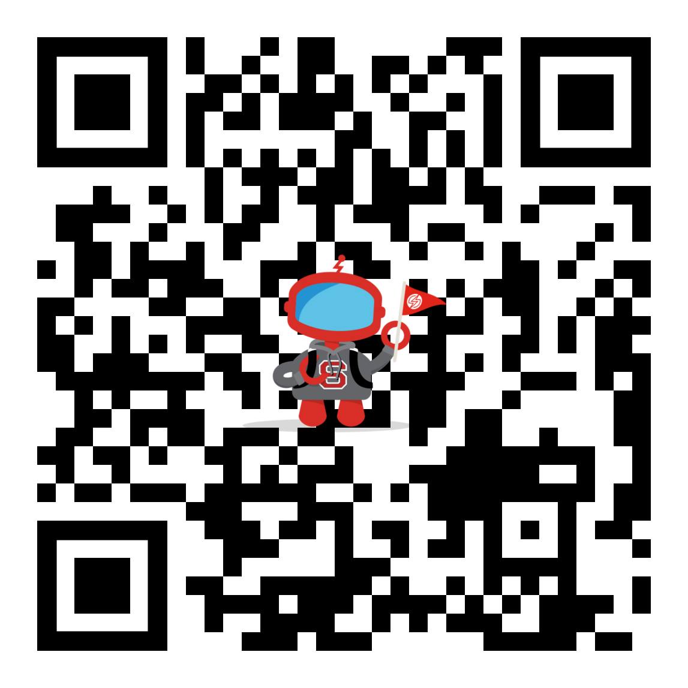

# my-demo-app-android

*My Demo App* is a demo app built by Sauce Labs to showcase the mobile device cloud, Backtrace Error Reporting, Sauce Mobile Beta, and related products.

## Backtrace + Sauce Mobile Beta example

The `feature/SauceMobileAppDistribution` branch demonstrates the new crashless Sauce Mobile Beta Android artifact running beside Backtrace:

- Backtrace is the sole JVM and native crash owner.
- Sauce Mobile Beta keeps the TestFairy-compatible `com.testfairy.TestFairy` API for sessions, feedback, screenshots, and remote logs.
- Both products carry the same correlation, environment, release, build, and optional distribution attributes. The app sets only the environment and distribution values; the Sauce Mobile Beta SDK generates a new `sauce.correlation_id` at every session start and writes its managed attributes into the Backtrace client linked with one line, `TestFairy.setBacktraceClient(backtraceClient)`.
- Sauce Mobile Beta is a debug-only dependency and is absent from release builds by construction.

Debug builds depend on the published release `com.saucelabs.mobilebeta:sauce-mobile-beta-android:2.3.0` from `https://maven.testfairy.com` by default.
Without a token and a server endpoint the app logs a warning and skips Sauce Mobile Beta, so a fresh clone and the CI build are unchanged.
Disable the dependency entirely with `-PsauceMobileBetaDisabled=true` (or `SAUCE_MOBILE_BETA_DISABLED=true`).

### Local project configuration

Add the credentials to the existing gitignored `local.properties` file. Use `local.properties.example` as the template:

```properties
backtraceSubmissionUrl=https://submit.backtrace.io/<universe>/<token>/json
sauceMobileBetaToken=<sauce-mobile-beta-token>
sauceMobileBetaEndpoint=<server-endpoint>
sauceEnvironment=beta
sauceDistributionId=
```

The token and the server endpoint both come from **Organization Settings > SDK Settings** on your Mobile App Distribution dashboard. The endpoint (`https://<host>/services/`) is required: the SDK's built-in default server is no longer in service, and the app logs a warning and skips Sauce Mobile Beta when either value is empty.

To pin a different published version or repository:

```properties
sauceMobileBetaVersion=2.3.0
sauceMobileBetaRepository=https://maven.testfairy.com
```

To build against a locally built SDK instead (development only), point at the AAR (it takes precedence over the published version):

```properties
sauceMobileBetaAar=/absolute/path/to/testfairy-android-sdk/sauce-mobile-beta-android/build/outputs/aar/sauce-mobile-beta-android-release.aar
```

`local.properties` is ignored by Git. Never place real credentials in `app/build.gradle`, committed Gradle property files, or source code.

### Build against the published artifact

```bash
./gradlew :app:assembleDebug
```

### Build against a local SDK AAR (development)

Build the SDK first:

```bash
cd ../testfairy-android-sdk
./gradlew :sauce-mobile-beta-android:assembleRelease
```

Then build this app. Values are loaded automatically from `local.properties`:

```bash
./gradlew :app:assembleDebug
```

Gradle `-P` properties and environment variables remain supported for CI. Their precedence is: command-line/project property, `local.properties`, environment variable, then safe default.
Supported environment variables include:
`BACKTRACE_SUBMISSION_URL`, `SAUCE_MOBILE_BETA_TOKEN`, `SAUCE_MOBILE_BETA_ENDPOINT`, `SAUCE_MOBILE_BETA_AAR`, `SAUCE_MOBILE_BETA_VERSION`, `SAUCE_MOBILE_BETA_DISABLED`, `SAUCE_ENVIRONMENT`, and `SAUCE_DISTRIBUTION_ID`.

The release workflow (`.github/workflows/publish-on-release.yml`) fills them from the repository secrets `BACKTRACE_UNIVERSE`, `BACKTRACE_TOKEN` (composed into `https://submit.backtrace.io/<universe>/<token>/json`), `SAUCE_MOBILE_BETA_TOKEN` and `SAUCE_MOBILE_BETA_ENDPOINT`, so the published APKs report to Backtrace and Sauce Mobile Beta.

The Backtrace URL must be the JSON submission URL (`…/json`, or a URL containing `format=json`): the native crash integration derives its minidump endpoint from it and is only enabled for those forms; JVM reporting works with any form. With the database enabled, reports are queued under `files/backtrace/` and resent until accepted.


The typed integration is in `app/src/mobileBeta/java/com/saucelabs/mydemoapp/android/SauceMobileBetaIntegration.java`.
When Backtrace is configured it links the client with `TestFairy.setBacktraceClient(backtraceClient)`, passes the Server Endpoint to `TestFairy.setServerEndpoint(BuildConfig.SAUCE_MOBILE_BETA_ENDPOINT)` and then calls `beginWithoutCrashHandler(...)` (the SDK then writes a new `sauce.correlation_id` and the session state into the client at every session start, and again when the start response arrives), disables auto-update for this demo, and verifies that the default (Backtrace) JVM handler remains installed. Each SDK is configured independently: Sauce Mobile Beta still starts when Backtrace is not configured.
The release source set uses a no-op adapter and does not receive the Sauce Mobile Beta dependency.

This app is part of a set of demo apps.

[My Demo App - Android](https://github.com/saucelabs/my-demo-app-android)

[My Demo App - iOS](https://github.com/saucelabs/my-demo-app-ios)

### QR code scanner

This app has a QR code scanner.
You can find it in the menu under the option "QR CODE SCANNER".
This page opens the camera (you first need to allow the app to use the camera) which can be used to scan a QR Code.
If the QR code holds an URL it will automatically open it in a browser. The [following image](./docs/assets/qr-code.png) can be used to demo this option.



## Publish

To publish a new version, create a release with a valid semver tag name. A CI workflow will handle setting the app version name/code and upload the APK into the release. 
